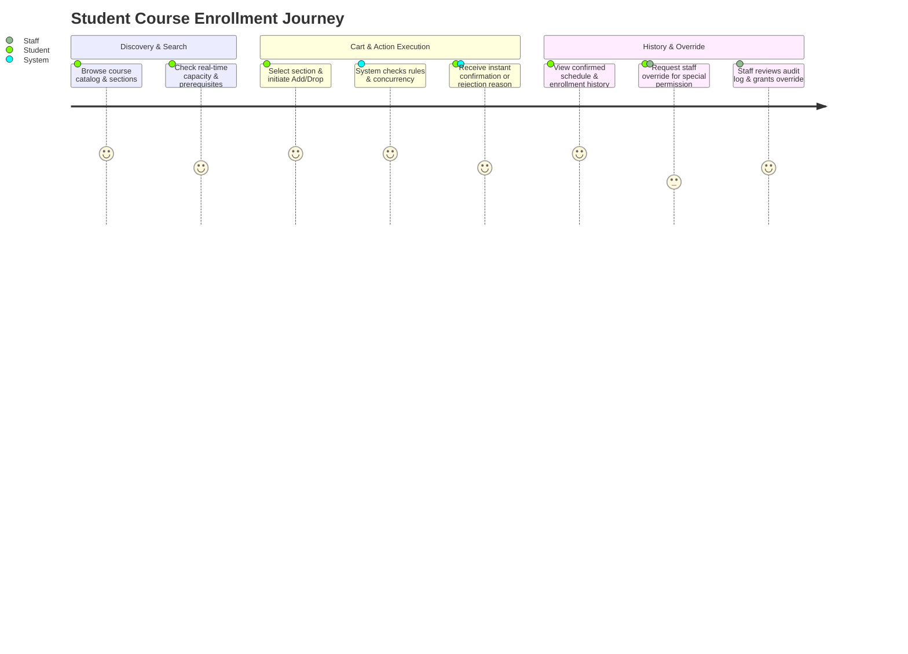

# Product Requirements Document (PRD)

# Enrollment Platform (Team 03)

---

## 1. Product Overview

### Product Name
**UniEnroll**: Real-time Course Enrollment and Add/Drop Management Platform

### Problem Statement
University course registration is plagued by severe bottlenecks during peak add/drop periods. Existing legacy registration portals suffer from:
1. **Seat Race Conditions & Oversubscription**: Concurrent registration requests often lead to over-allocated section seats or database locking crashes.
2. **Prerequisite & Rule Ambiguity**: Students receive generic, unhelpful rejection messages without actionable context when prerequisite rules, credit caps, or timetable constraints are violated.
3. **Siloed Downstream Systems**: Changes in enrollment status fail to propagate in real-time to downstream services (Timetable & Room Scheduling, Attendance Tracking, Notification Hub, and Analytics), leading to operational delays and inconsistent state across the university.

### Target Users
- **Undergraduate & Graduate Students**: Need a responsive, transparent interface to search available sections, add/drop courses, inspect prerequisite eligibility in real time, and receive clear feedback on registration decisions.
- **Academic Advisors & Registrar Staff**: Need an administrative console to audit student registration history, process late-add/withdraw requests, and grant authorized prerequisite/capacity overrides.
- **Downstream Platform Subsystems (System Consumers)**: Require reliable, idempotent webhook notifications when enrollment state changes occur.

### Product Goal
Deliver a robust, cloud-ready, zero-cost-tier course enrollment service for university operations that guarantees atomic capacity allocation, enforces strict prerequisite graph verification, provides deterministic and human-friendly rule validation feedback for failed attempts, and broadcasts idempotent event streams to downstream university services.

---

## 2. Scope

### In Scope
- **Student Enrollment Lifecycle**: Real-time course section search, seat reservation check, section add, section drop, section swap (patch), and post-deadline withdrawal requests.
- **Rule & Prerequisite Engine**: Real-time validation of course prerequisites, credit hour minimum/maximum constraints, and time conflict detection.
- **Atomic Capacity Protection**: Concurrency-safe seat reservation using database-level row locking (`SELECT FOR UPDATE`) / optimistic concurrency control.
- **Deterministic Rule Decision & Error Messaging Engine**: Structured, human-readable explanations of enrollment rejection reasons directly mapped from rule validation codes without third-party AI dependency.
- **Inter-team Webhook Dispatcher**: Asynchronous event publishing (`enrollment.changed`) with retry mechanism and idempotency keys to external university systems.
- **Staff Override & Audit Console**: Authorized administrative overrides for prerequisite or capacity exceptions with complete audit trails.
- **Core User Interface**: 3 responsive web screens covering the complete student journey and staff operations.

### Out of Scope
- **Tuition & Payment Gateway Processing**: Handled by the University Bursar & Payment Gateway platform.
- **Classroom Physical Room Allocation**: Managed by the Timetable & Facility Scheduling system (consumes enrollment webhook).
- **Attendance Record Management**: Handled by the Student Attendance system (consumes enrollment webhook).
- **Curriculum & Syllabus Authoring**: Handled by the Central Academic Catalog service.

---

## 3. User Roles

### Student (`ROLE_STUDENT`)
- Authenticates via University Single Sign-On (SSO / Supabase Auth).
- Can search available sections, view real-time seat availability, inspect prerequisite trees, add/drop sections within active enrollment windows, swap sections, and view enrollment history and status.
- Cannot view other students' enrollments or perform administrative overrides.

### Academic Registrar / Staff (`ROLE_STAFF`)
- Authenticates with elevated academic staff privileges.
- Can look up student enrollment records, review rule rejection logs, execute authorized section capacity overrides or prerequisite waivers, and approve withdrawal requests.

### System Administrator / Service Consumer (`ROLE_SYSTEM`)
- Secure service-to-service integration via API Keys / Signed Webhook HMAC tokens.
- Consumes published `enrollment.changed` webhooks and queries availability status.

---

## 4. User Journey

---

## 5. Functional Requirements

### FR-01: Real-time Section Search & Seat Availability
- The system must provide searchable course section listings with real-time seat status (`total_capacity`, `enrolled_count`, `available_seats`).
- The system must evaluate student eligibility flags dynamically for each displayed section.

### FR-02: Atomic Section Registration (Add)
- The system must accept enrollment requests (`POST /enrollments`) and execute validation within an isolated database transaction.
- The system must atomically decrement seat count and prevent negative available seats under high concurrent load.

### FR-03: Section Drop and Swap Execution
- The system must allow students to drop active enrollments (`DELETE /enrollments/{id}`) during the active drop window, incrementing available seats.
- The system must support atomic section swapping (`PATCH /enrollments/{id}`) ensuring the student does not lose their current seat if the target section is full or fails validation.

### FR-04: Automated Prerequisite & Rule Validation
- The system must validate student transcript history against course prerequisite rules before granting enrollment.
- The system must enforce semester maximum and minimum credit hour thresholds (e.g., Min: 9 credits, Max: 22 credits).

### FR-05: Deterministic Decision Explanation & Rule Validation Engine
- For any rejected enrollment attempt, the system must evaluate all validation rules deterministically and return standardized, human-readable error messages and structured failure details.

### FR-06: Inter-Team Event Webhook Dispatch
- Upon every successful enrollment state transition (`ENROLLED`, `DROPPED`, `WITHDRAWN`, `OVERRIDDEN`), the system must publish an idempotent `enrollment.changed` webhook to registered downstream consumers.

### FR-07: Authorized Staff Override & Audit Trail
- The system must allow authorized staff (`ROLE_STAFF`) to bypass capacity or prerequisite rules via `POST /overrides`.
- Every override action must generate an immutable `OverrideLog` record.

---

## 6. Non-Functional Requirements

### NFR-01: Performance & Concurrency
- **Response Time**: 95% of enrollment API requests must complete in under **400ms** under normal load.
- **Concurrency Safety**: Zero over-enrollment incidents under concurrent registration bursts.

### NFR-02: Security & Authorization
- **Authentication**: JWT-based authentication.
- **Role-Based Access Control (RBAC)**: Strict separation between `ROLE_STUDENT` and `ROLE_STAFF`.

### NFR-03: Availability & Reliability
- **System Availability**: 99.5% uptime during active university enrollment periods.
- **Idempotency**: State-modifying endpoints support `Idempotency-Key` headers.

### NFR-04: Cost & Deployment Constraint
- **Budget**: Exactly **0 THB / $0 USD** deployment cost.
